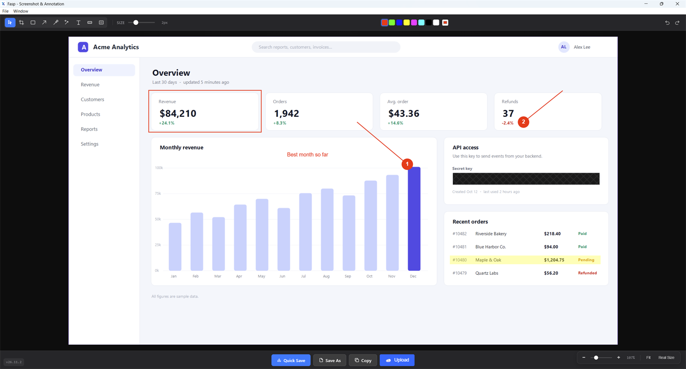
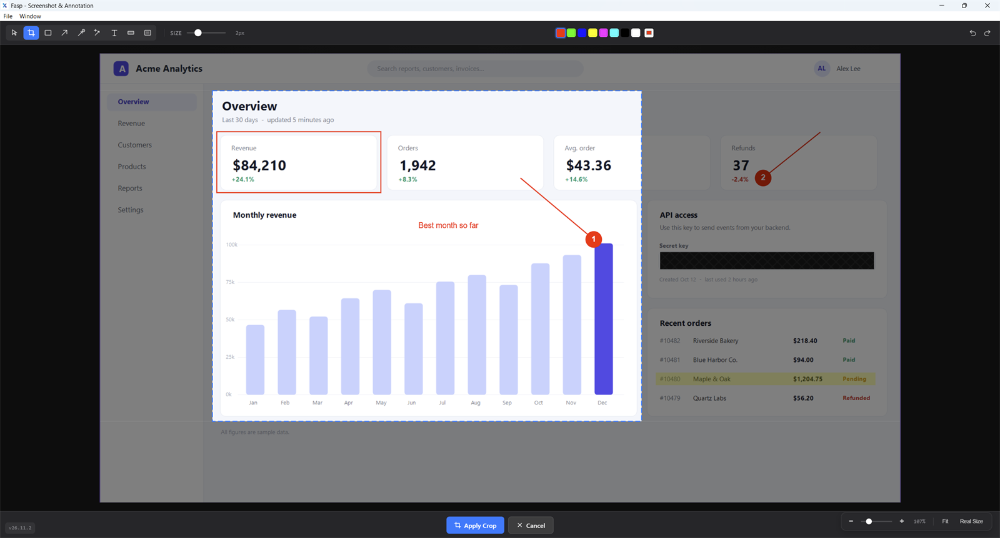
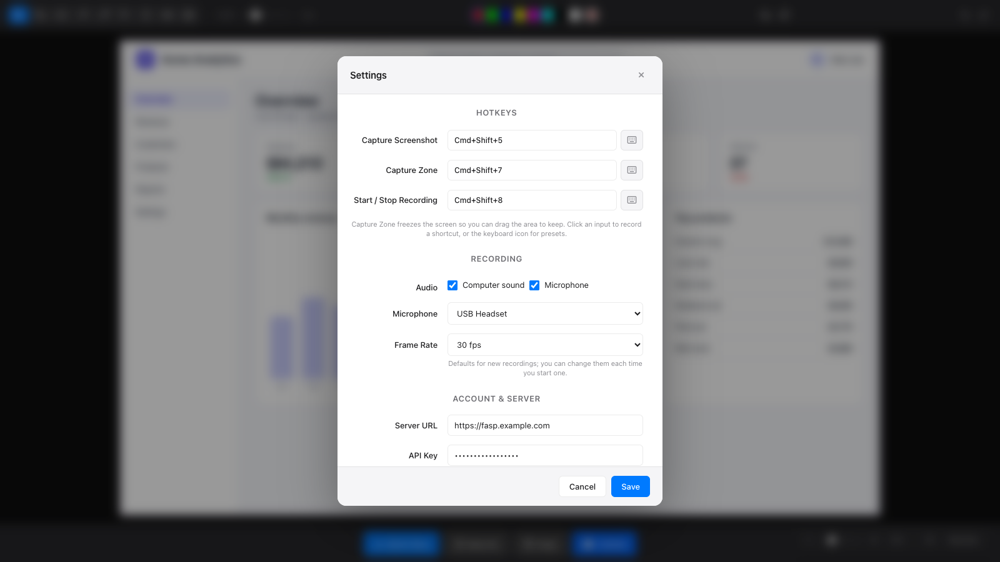

# Fasp

**Fast screenshot and annotation for Windows and macOS.** Press a hotkey, mark up the capture with boxes, arrows, numbered steps, text, highlights and blur, then copy, save or upload it in a second.



## Features

- **Global hotkeys**: capture the screen under the mouse cursor from anywhere, even with the editor hidden.
- **Native capture**: GDI on Windows, ScreenCaptureKit on macOS, in-process with no helper scripts; full resolution on scaled (HiDPI) displays.
- **Annotation tools**: rectangle, arrow, numbered arrow, arrow with text, text, highlight and blur, in eight colours and five sizes.
- **Blur that really hides things**: the blur box is fully opaque, so nothing underneath survives in the exported image.
- **Capture Zone**: freeze the screen, drag the area you want, and only that area opens in the editor (Windows; macOS coming).
- **Screen recording**: record the full screen, one window or a region to MP4 (H.264 + AAC), with computer sound and/or a microphone, using the native hardware encoder (Windows; macOS coming).
- **Crop** after capturing, before you share.
- **Zoom and pan**: zoom with Ctrl + mouse wheel, hold Shift and drag to move around a large capture.
- **Copy, save or upload**: copy to the clipboard, quick-save to a folder, save as PNG or JPEG, or upload to a fasp server and get a link.
- **Tray icon** with recent screenshots, and an option to start at login.
- **Open any image** (PNG, JPEG, GIF, BMP, WebP) to annotate it.

## Install

### Windows

1. Download **`fasp-amd64-installer.exe`** from the [latest release](https://github.com/toniim/fasp-app/releases/latest).
   A portable `fasp.exe` is attached too.
2. Run the installer. It installs to `C:\Program Files\fasp\fasp` and fetches the Microsoft Edge WebView2 runtime if it is missing.
   The installer is not code-signed yet, so Windows SmartScreen may warn you: choose **More info → Run anyway**.
3. Fasp starts in the system tray. Press **PrintScreen** to capture.

Requires Windows 10 (1909) or later.

### macOS

Requires macOS 14 (Sonoma) or later, on Apple Silicon or Intel.

1. Download **`fasp-macos-universal.zip`** from the [latest release](https://github.com/toniim/fasp-app/releases/latest) and unzip it (Safari does this for you).
2. Drag **`fasp.app`** into your **Applications** folder.
3. **Allow it to open (once).** Fasp is open source and not signed with a paid Apple Developer ID, so macOS blocks the first launch with *"Apple could not verify 'fasp' is free of malware"*. Either:
   - double-click `fasp.app`, click **Done**, then open **System Settings → Privacy & Security**, scroll down to *"fasp" was blocked…* and click **Open Anyway** (confirm with your password); or
   - run this once in Terminal:
     ```bash
     xattr -dr com.apple.quarantine /Applications/fasp.app
     ```
     This is also the fix if macOS says the app *"is damaged and can't be opened"*.
4. **Allow screen recording.** On the first capture macOS asks for permission: turn **fasp** on under **System Settings → Privacy & Security → Screen & System Audio Recording** (*Screen Recording* on macOS 14), then quit Fasp from the menu bar icon and open it again.
5. Fasp lives in the menu bar. Press **Cmd+Shift+5** to capture.

**After updating**, repeat steps 3 and 4: because the app is not signed with a Developer ID, macOS treats each version as a new app and drops the old Screen Recording permission. If the toggle is already on but captures fail, remove **fasp** from that list with **−** (or run `tccutil reset ScreenCapture com.wails.fasp`) and grant it again.

You can also build it yourself; see [Development](#development).

## Usage

### Capture

| Hotkey | Windows | macOS |
|---|---|---|
| Capture (set in Settings) | `PrintScreen` | `Cmd+Shift+5` |
| Second capture hotkey | `Ctrl+Shift+S` | `Cmd+Shift+6` |
| Capture Zone | `Shift+PrintScreen` | `Cmd+Shift+7` |
| Start / stop recording | `Ctrl+PrintScreen` | `Cmd+Shift+8` |

Both capture the screen under the mouse cursor and open it in the editor with the **Crop** tool ready: drag to keep part of it, or pick another tool to annotate the whole capture.
The editor hides itself first, so it never appears in its own screenshot.

You can also capture from the tray menu or **File → Capture Screenshot**, and open an existing image with **File → Open Image…** (`Ctrl+O`).

### Capture a zone

Press the **Capture Zone** hotkey (or **File → Capture Zone**, or the tray menu). The screen under the mouse freezes and dims; drag the area you want and release. Only that area opens in the editor, with the Select tool ready.

- `Enter` takes the whole screen, `Esc` or a right-click cancels.
- A size label shows the selection in pixels while you drag.

### Record the screen

Press the **Start / stop recording** hotkey (or **File → Record Screen…**, or the tray menu) and choose:

| Mode | Records |
|---|---|
| Full screen | The screen under the mouse pointer |
| Window | One window, picked from a list, even while other windows cover it. Recording stops by itself when the window closes |
| Region | An area you drag on the frozen screen after pressing **Select Region** |

Tick **Computer sound** (everything the computer plays) and/or **Microphone** (pick the device). Both are mixed into one audio track. With speakers, the microphone also hears the computer sound, so use headphones to avoid an echo. Your choices become the defaults for the next recording.

While recording, Fasp shrinks to a small bar at the top of the screen with a timer and **Stop**. The bar never appears in the video. Press the hotkey again, click **Stop**, or use the tray menu to finish.

The MP4 is saved in the Quick Save folder (`Recording_<date>_<time>.mp4`) and opens right away in the editor's player, just as a screenshot opens in the editor:

| Button | Shortcut | Result |
|---|---|---|
| Copy | `Ctrl+C` | Puts the video file on the clipboard, ready to paste into a chat, an email or a folder |
| Save As | `Ctrl+Shift+S` | Saves a copy elsewhere |
| Show in Folder | | Opens the folder with the file |
| Upload | | Uploads the video to your fasp server and copies the link |
| | `Space` / `K`, `←` `→` | Play/pause, skip 5 s |
| | `Esc` | Close the player |

Recordings in the tray **Recents** open in the same player.

Windows 10 draws a yellow border around what is being recorded; Windows 11 does not.

### Annotate

Pick a tool in the toolbar or press its key, choose a colour and a size, then drag on the image.

| Tool | Key | What it does |
|---|---|---|
| Select | `S` | Select, move, resize and rotate annotations; drag on empty space to select several |
| Crop | `C` | Drag the area to keep, then **Apply Crop** (`Enter`) or **Cancel** (`Esc`) |
| Rectangle | `R` | Outline an area |
| Arrow | `A` | Point at something |
| Numbered arrow | `N` | Arrow with a step number that counts up: 1, 2, 3… |
| Arrow with text | `W` | Arrow with a label at its tail |
| Text | `T` | Drag a box and type; `Enter` adds a line, `Esc` or clicking away finishes |
| Highlight | `H` | Translucent marker over text |
| Blur | `B` | Opaque pattern that hides passwords, keys and personal data |

Size: `[` and `]`, or `Ctrl+1` … `Ctrl+5`. Undo `Ctrl+Z`, redo `Ctrl+Shift+Z`. Delete the selection with `Delete`, `Backspace` or `Ctrl+D`; select everything with `Ctrl+A`.



### Zoom and pan

- **Zoom**: `Ctrl` + mouse wheel zooms towards the cursor; the zoom bar has **−**, **+**, **Fit** and **Real Size** (pixel-exact).
- **Pan**: when the image is larger than the editor, hold **Shift** and drag from anywhere, with any tool, to move the view. `Ctrl` + drag on the image does the same. The mouse wheel scrolls; `Shift` + wheel scrolls sideways.

### Copy, save and upload

| Button | Shortcut | Result |
|---|---|---|
| Quick Save | `Ctrl+S` | Saves to the default folder (`Pictures\Fasp` unless set in Settings) |
| Save As | `Ctrl+Shift+S` | Choose a file name and format (PNG or JPEG) |
| Copy | `Ctrl+C` | Puts the annotated image on the clipboard |
| Upload | | Uploads to your fasp server and copies the link (see Settings) |
| | `Ctrl+Shift+C` | Cancels a crop, or hides the editor |

> On Windows, `Ctrl+Shift+S` is also the default second capture hotkey, which is global and wins: in the editor it starts a new capture instead of Save As. Use the **Save As** button, or change that hotkey in `settings.json` (`hotkeys.capture_region`).

On macOS, use `Cmd` in place of `Ctrl` for the editor shortcuts.

### Tray menu

Capture Screenshot, Capture Zone, Record Screen / Stop Recording, Open Image…, **Recents** (your latest saved screenshots and their folder), Show/Hide Window, Settings… and Quit.
On Windows, closing the editor window only hides it and Fasp keeps running in the tray; use **Quit** to exit.

### Settings

Open **Settings** from the tray or with `Ctrl+,`.



- **Hotkeys**: Capture Screenshot, Capture Zone and Start / Stop Recording. Click a field and press a new combination, or pick a preset. One combination can only be used once.
- **Recording**: the default audio sources, microphone and frame rate (15, 30 or 60 fps) for new recordings.
- **Account & Server**: the fasp server URL and an API key (create one in fasp under Settings → API Keys, scope `files:write`), with **Test Connection**.
- **Run at Startup**: start Fasp when you log in.
- **Save Options**: default folder and format for Quick Save.
- **Upload Options**: after an upload, copy the direct URL, the public URL, Markdown image code, or nothing.

Settings are stored in `%APPDATA%\fasp\settings.json` on Windows and `~/Library/Application Support/fasp/settings.json` on macOS. The file holds your API key, so it is readable only by you.

## Troubleshooting

- **A hotkey does nothing (Windows).** Another app may own it. Windows 11 can reserve `PrintScreen` for the Snipping Tool: turn off **Settings → Accessibility → Keyboard → Use the Print screen key to open screen capture**, or pick another hotkey in Fasp.
- **macOS won't open the app, or says it is damaged.** See step 3 of [Install → macOS](#macos): **Open Anyway** in Privacy & Security, or `xattr -dr com.apple.quarantine /Applications/fasp.app`.
- **Captures are black or only show the wallpaper (macOS).** Grant **Screen Recording** permission and restart Fasp. After an update, remove fasp from the Screen Recording list and grant it again. For your own builds, `make build-darwin-signed` with a local certificate (`scripts/create-dev-certificate.sh`) keeps the permission across rebuilds.
- **Cmd+Shift+5 opens the macOS screenshot toolbar instead (macOS).** Pick another hotkey in Fasp Settings, or turn off that shortcut under **System Settings → Keyboard → Keyboard Shortcuts → Screenshots**.
- **Recording says the microphone access is denied (Windows).** Turn on **Settings → Privacy & security → Microphone → Let desktop apps access your microphone**.
- **A recording has no computer sound.** Fasp records the default output device; sound played on another device is not included. If the default device changes during a recording, Fasp switches to the new one and that moment is silent.
- **SmartScreen blocks the installer.** The installer is not code-signed yet: **More info → Run anyway**.

## Development

Requirements: Go (version in `go.mod`), Node.js 18+, and the [Wails](https://wails.io) CLI at the version pinned in `go.mod`.
`make install` installs the right Wails CLI; the build targets stop with a hint if yours differs.

```bash
git clone https://github.com/toniim/fasp-app.git
cd fasp-app
make install          # Go modules, frontend packages, pinned Wails CLI
make dev              # run with hot reload
make build            # production build for this OS, into build/bin
make build-windows    # Windows NSIS installer
make build-darwin-signed  # macOS app, signed so Screen Recording permission survives rebuilds
make test             # Go tests
```

The wails targets run on the Go toolchain from `go.mod` (through `GOTOOLCHAIN`), matching CI.
Without `make`, run the same `wails build` command with `GOTOOLCHAIN` set to that version.

### Releasing

1. Bump `Version` in `internal/version/version.go` (format `vYY.M.PATCH`) and merge it to `main`.
2. Run `make release` (or `scripts/release.sh`): it tags the commit and pushes the tag.
3. The Release workflow builds the Windows app and installer and the macOS app (universal, ad-hoc signed and zipped by `scripts/package-macos.sh`, then launched by `scripts/smoke-macos.sh`), and publishes them together as a GitHub release.

Every pull request also builds, packages and smoke-tests the macOS app; the zip is attached to the CI run as the `fasp-macos-universal` artifact for 7 days. To build release files without publishing, run the Release workflow by hand from the Actions tab.

### Project layout

```
main.go                      Wails app, bindings for the frontend, window and tray wiring
app_zone.go                  Capture Zone and region selection bindings
app_recording.go             Recording bindings, the recording bar, saving and results
app_media.go                 Serves recordings to the in-app player, copy as file, Save As
focus_windows.go             Gives the web view keyboard focus when the editor is shown
exclude_capture_windows.go   Keeps the Fasp window out of recordings
cmd/recspike/                Command-line recorder for measuring the pipeline without the UI
internal/
  model/                     Settings and capture types
  service/
    capture/                 Screen capture (GDI on Windows, ScreenCaptureKit on macOS), Capture Zone overlay
    recorder/                Screen recording: Windows.Graphics.Capture + Media Foundation, WASAPI audio and mixer
    clipboard/               Copy images (Win32 clipboard, NSPasteboard)
    hotkey/                  Global hotkeys
    file/                    Save/open dialogs, default save folder
    recents/                 Recently saved screenshots
    settings/                settings.json persistence
    startup/                 Start at login
    upload/                  Upload to a fasp server
    permission/, shell/      OS permissions, opening files and folders
  tray/                      System tray menu
  version/                   Version stamped at build time
frontend/src/
  components/EditorWindow/   Konva canvas editor, toolbar, zoom bar, action bar
  components/SettingsWindow/ Settings dialog and shortcut field
  components/Recording/      Record dialog, recording bar, "recording failed" panel
  components/VideoViewer/    In-app player for recordings
  store/                     Zustand stores
  utils/editor-geometry.ts   Fit, zoom and pan maths
build/                       Icons, Windows manifest and installer, macOS plists
docs/                        Design notes and architecture docs
```

Platform code lives in `_windows.go` / `_darwin.go` files. More background is in [`docs/`](docs/): [system architecture](docs/system-architecture.md), [code standards](docs/code-standards.md) and the [roadmap](docs/project-roadmap.md).

## License

[MIT](LICENSE)
