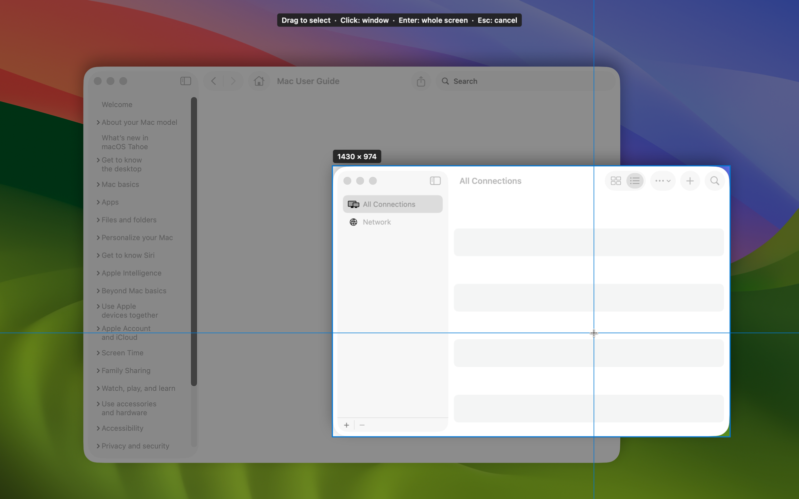
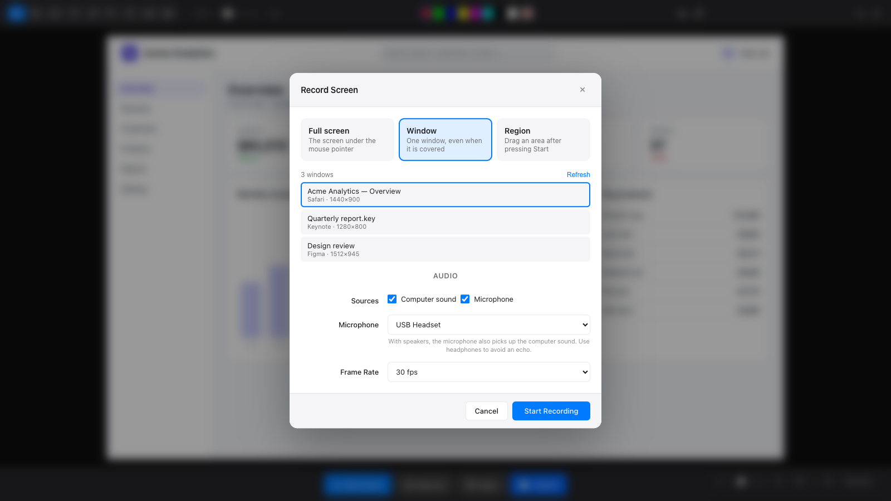
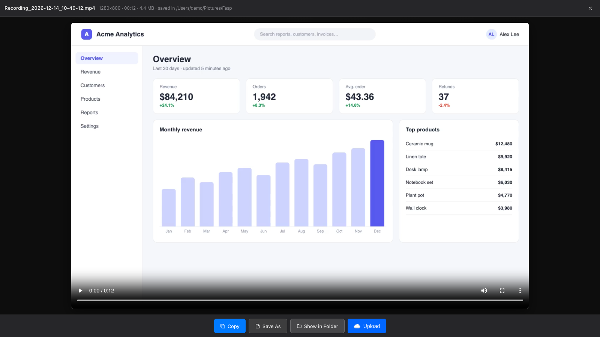
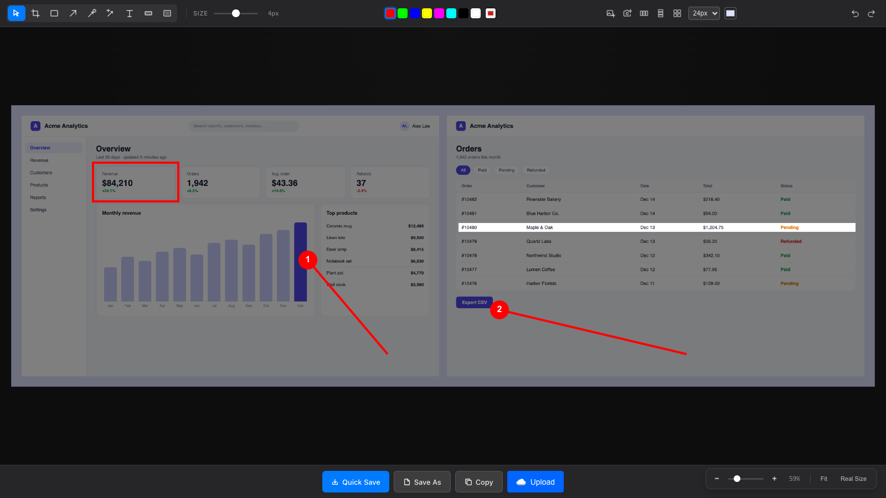
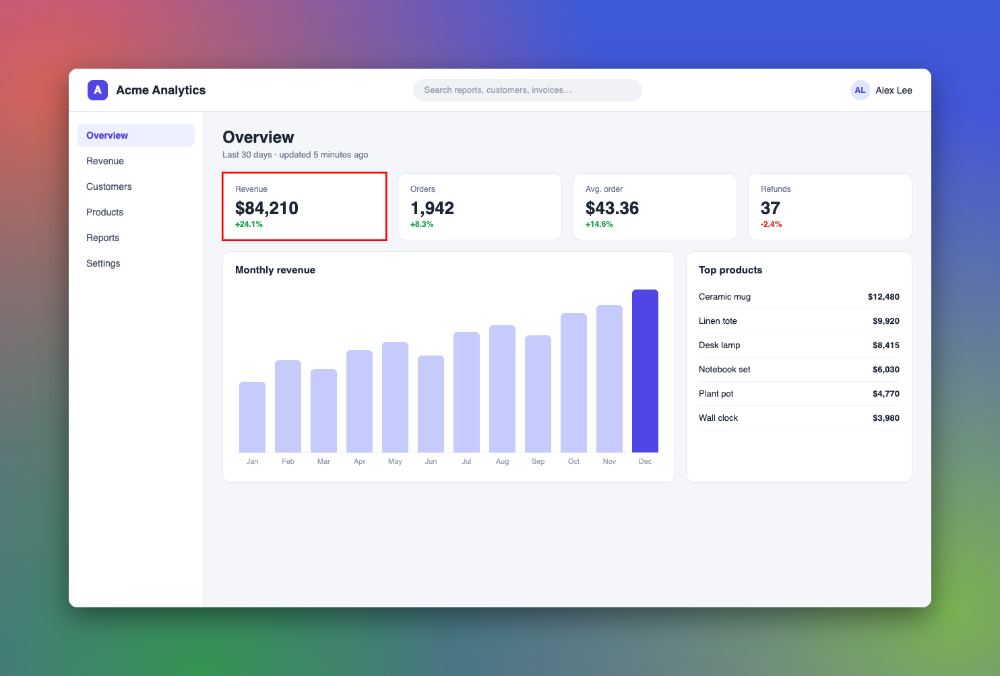

# Fasp

**Fast screenshots, annotation and screen recording for Windows and macOS.** Press a hotkey, mark up the capture with boxes, arrows, numbered steps, text, highlights and blur, then copy, save or upload it in a second. Freeze the screen to grab just one area, put several shots side by side on one canvas, or record the screen to MP4.


## Features

- **Global hotkeys**: capture the screen under the mouse cursor from anywhere, even with the editor hidden.
- **Native capture**: GDI on Windows, ScreenCaptureKit on macOS, in-process with no helper scripts; full resolution on scaled (HiDPI) displays.
- **Annotation tools**: rectangle, arrow, numbered arrow, arrow with text, text, highlight and blur, in eight colours and five sizes.
- **Blur that really hides things**: the blur box is fully opaque, so nothing underneath survives in the exported image.
- **Capture Zone (freeze shot)**: the screen freezes, you drag the area you want, and only that area opens in the editor. Menus, tooltips and hover states stay exactly as they were when you pressed the hotkey.
- **Several images on one canvas**: add more screenshots, image files, a pasted image or files dropped on the editor; move, resize and reorder them, and arrange them in a row, a column or a grid.
- **Screen recording**: record the full screen, one window or a region to MP4 (H.264 + AAC), with computer sound and/or a microphone, using the native hardware encoder. Fasp's own recording bar never appears in the video.
- **Built-in player**: a recording opens in the editor's player, ready to copy as a file, save or upload. Trim it, or turn a part of it into a GIF.
- **Pin to screen**: float a shot on top of everything, on every desktop, as a reference while you work.
- **Text from the screen (OCR)**: drag a zone and its text goes to the clipboard, or copy the text of a shot in the editor. It uses the system's own text recognition, so nothing is uploaded.
- **Crop** after capturing, before you share.
- **Backdrop**: put the shot on a background with a margin, rounded corners and a shadow, ready to post.
- **Zoom and pan**: zoom with Ctrl + mouse wheel, hold Shift and drag to move around a large capture.
- **Copy, save or upload**: copy to the clipboard, quick-save to a folder, save as PNG or JPEG, or upload to a fasp server and get a link.
- **Tray icon** with recent screenshots, and an option to start at login.
- **Open any image** (PNG, JPEG, GIF, BMP, WebP) to annotate it, or paste one from the clipboard.

## Install

### Windows

1. Download **`fasp-amd64-installer.exe`** from the [latest release](https://github.com/toniim/fasp-app/releases/latest).
   A portable `fasp.exe` is attached too.
2. Run the installer. It installs to `C:\Program Files\fasp\fasp` and fetches the Microsoft Edge WebView2 runtime if it is missing.
   The installer is not code-signed yet, so Windows SmartScreen may warn you: choose **More info → Run anyway**.
3. Fasp starts in the system tray. Press **PrintScreen** to capture.

Requires Windows 10 (1909) or later.

### macOS

Requires macOS 14 (Sonoma) or later, on Apple Silicon or Intel.

1. Download **`fasp-macos-universal.zip`** from the [latest release](https://github.com/toniim/fasp-app/releases/latest) and unzip it (Safari does this for you).
2. Drag **`fasp.app`** into your **Applications** folder.
3. **Allow it to open (once).** Fasp is open source and not signed with a paid Apple Developer ID, so macOS blocks the first launch with *"Apple could not verify 'fasp' is free of malware"*. Either:
   - double-click `fasp.app`, click **Done**, then open **System Settings → Privacy & Security**, scroll down to *"fasp" was blocked…* and click **Open Anyway** (confirm with your password); or
   - run this once in Terminal:
     ```bash
     xattr -dr com.apple.quarantine /Applications/fasp.app
     ```
     This is also the fix if macOS says the app *"is damaged and can't be opened"*.
4. **Allow screen recording.** On the first capture macOS asks for permission: turn **fasp** on under **System Settings → Privacy & Security → Screen & System Audio Recording** (*Screen Recording* on macOS 14), then quit Fasp from the menu bar icon and open it again. The same permission covers Capture Zone, screen recording and computer sound.
5. Fasp lives in the menu bar. Press **Cmd+Shift+5** to capture.

The first time you record with the **Microphone** ticked, macOS asks for microphone access; click **Allow**. If you clicked **Don't Allow**, turn **fasp** on under **System Settings → Privacy & Security → Microphone**.

**After updating**, repeat step 3. Screen Recording stays allowed: releases are signed with the same certificate every time, so macOS sees the new version as the same app. The one exception is the first update from v26.11.4 or older, which were signed differently: grant Screen Recording once more. If the toggle is already on but captures fail, remove **fasp** from that list with **−** (or run `tccutil reset ScreenCapture com.wails.fasp`) and grant it again.

You can also build it yourself; see [Development](#development).

## Usage

### Capture

| Hotkey | Windows | macOS |
|---|---|---|
| Capture (set in Settings) | `PrintScreen` | `Cmd+Shift+5` |
| Second capture hotkey | `Ctrl+Shift+S` | `Cmd+Shift+6` |
| Capture Zone | `Shift+PrintScreen` | `Cmd+Shift+7` |
| Start / stop recording | `Ctrl+PrintScreen` | `Cmd+Shift+8` |
| Capture Text | `Ctrl+Shift+9` | `Cmd+Shift+9` |

Both capture the screen under the mouse cursor and open it in the editor with the **Crop** tool ready: drag to keep part of it, or pick another tool to annotate the whole capture.
A hotkey (or the tray menu) takes the screen as it is: if the editor is open, it is in the shot, which is handy for showing Fasp itself. The **Capture** buttons inside Fasp and **Add screenshot** in the editor hide the editor first, so it is not in those shots.

You can also capture from the tray menu or **File → Capture Screenshot**, and open an existing image with **File → Open Image…** (`Ctrl+O`).

### Capture a zone (freeze shot)

Press the **Capture Zone** hotkey (or **File → Capture Zone**, or the tray menu). The screen under the mouse freezes and dims; drag the area you want and release. Only that area opens in the editor, at full pixel resolution, with the Select tool ready.

Because the picture is taken the moment you press the hotkey, you can grab things that disappear as soon as you click: an open menu, a tooltip, a hover state, a frame of a video.

- Click without dragging to take the window under the mouse. Before you click, that window is shown undimmed with a border and its size, so you see what you will get.

  

  Only the part of the window you see on the frozen screen is taken: whatever covered the window then is in the picture too. A click on the desktop does nothing.
- `Enter` takes the whole screen, `Esc` or a right-click cancels: the screen stays as it was and the app you were in keeps the focus. The editor comes back only if you started from it.
- A size label shows the selection in pixels while you drag.
- With several displays, the display under the mouse freezes.
- If the editor already holds a shot, the new zone replaces it. To keep the current shot and add another one next to it, use **Add screenshot** in the editor instead (see [Several images on one canvas](#several-images-on-one-canvas)).

### Repeat the last zone

**Repeat Last Zone** (tray menu, or a hotkey you set in Settings; there is none by default) captures the area you picked last in Capture Zone again, straight away and without the overlay, and opens it in the editor with the same pixel size. Fasp remembers the zone and its display across restarts. If that display is gone or has another resolution, nothing is captured and a message says so.

### Delayed capture

The tray menu has **Delayed Capture** with **Capture in 3 / 5 / 10 s** and **Capture Zone in 3 / 5 / 10 s**. The seconds left show next to the tray icon (macOS) or in its tooltip (Windows), so they are never in the picture. The screen is captured when the countdown ends; for a zone, the overlay then freezes the screen. To cancel, press `Esc` (a global key, held only while counting), choose **Cancel Countdown** in the tray menu, or choose a delayed item again.

### Capture text (OCR)

Press the **Capture Text** hotkey (or **File → Capture Text**). The zone overlay opens, the same as Capture Zone: drag an area, or click a window. The text in it is copied to the clipboard and the editor does not open. A short message says how many lines were copied, or "No text found". It appears in the editor when the editor is showing, and as a system notification when it is hidden (macOS asks once to allow notifications).

In the editor, **Copy Text** reads the text of the whole shot, annotations included, and copies it.

Text recognition is done by the system: Vision on macOS, Windows.Media.Ocr on Windows. On Windows it needs an OCR language: if none is installed, the message tells you to add one under Settings → Time & language → Language & region. **Settings → Text Recognition → Language** sets a language hint; **Automatic** lets the system choose.

### Pin a shot to the screen

**Pin** in the editor's action bar opens the picture you would copy (annotations included) in its own borderless window that stays above other apps and shows on every Space or virtual desktop. It opens at its natural size, shrunk to fit within 80% of the screen, over the editor. You can open several pins; they do not depend on the editor, so closing or hiding it keeps them.

| Action | Result |
|---|---|
| Drag | Moves the pin |
| Mouse wheel, or a pinch on the trackpad | Zooms around the cursor |
| Double-click | Back to 100% (the size it opened at) |
| Hover toolbar | **Opacity** (click to step through 100, 75, 50 and 25 %), Copy, Save As, Close |
| `Esc` | Closes the focused pin |

Pins are ordinary windows, so they show up in Fasp's own screenshots and recordings.

### Record the screen

Press the **Start / stop recording** hotkey (or **File → Record Screen…**, or the tray menu) and choose:

| Mode | Records |
|---|---|
| Full screen | The screen under the mouse pointer |
| Window | One window, picked from a list, even while other windows cover it. Recording stops by itself when the window closes |
| Region | An area you drag on the frozen screen after pressing **Select Region**, or the area of the window you click there |



Pick the frame rate (15, 30 or 60 fps), then tick **Computer sound** (everything the computer plays) and/or **Microphone** (pick the device). Both are mixed into one audio track. With speakers, the microphone also hears the computer sound, so use headphones to avoid an echo. Your choices become the defaults for the next recording.

On macOS, computer sound needs no extra permission (it comes with Screen Recording), and Fasp's own sounds are left out. The microphone asks for permission the first time (see [Install → macOS](#macos)).

While recording, Fasp shrinks to a small bar at the top of the screen with a timer and **Stop**. The bar never appears in the video. Press the hotkey again, click **Stop**, or use the tray menu to finish.

The MP4 is saved in the Quick Save folder (`Recording_<date>_<time>.mp4`) and opens right away in the editor's player, just as a screenshot opens in the editor:



| Button | Shortcut | Result |
|---|---|---|
| Copy | `Ctrl+C` | Puts the video file on the clipboard, ready to paste into a chat, an email or a folder |
| Save As | `Ctrl+Shift+S` | Saves a copy elsewhere |
| Show in Folder | | Opens the folder with the file |
| Upload | | Uploads the video to your fasp server and copies the link |
| Save Trimmed… | | Saves the part between the two trim handles as a new MP4 |
| Export GIF… | | Makes a looping GIF of the part between the handles |
| | `Space` / `K`, `←` `→` | Play/pause, skip 5 s |
| | `Esc` | Close the player |

**Trim and GIF.** Under the video, a timeline has two handles: drag them, use `←` `→` on a focused handle (`Shift` for 1 s steps), or play to a moment and press **Set Start** / **Set End**. The start, end and length show next to the buttons; **Reset** takes the whole video back. **Save Trimmed…** asks where to save, then trims in the background; audio and video are cut at the same times. **Export GIF…** asks for the frame rate (8, 10, 12 or 15 fps) and the width (original up to 960 px, 640 px or 480 px) and shows the estimated size before it starts. A progress bar follows the export and **Cancel** stops it. When it is ready, **Save As…** picks a place, **Quick Save** writes it to the default folder and **Copy** puts the GIF file on the clipboard, like a video.

Recordings in the tray **Recents** open in the same player.

Windows 10 draws a yellow border around what is being recorded; Windows 11 does not.

### Annotate

Pick a tool in the toolbar or press its key, choose a colour and a size, then drag on the image. To change an annotation you already drew, select it (or several, with a drag on empty canvas or `Ctrl+A`) and pick another colour or size: it applies to the selection, as one undo step.

| Tool | Key | What it does |
|---|---|---|
| Select | `S` | Select, move, resize and rotate annotations; drag on empty space to select several |
| Crop | `C` | Drag the area to keep, then **Apply Crop** (`Enter`) or **Cancel** (`Esc`). Crops the selected image, or the whole canvas when no image is selected |
| Rectangle | `R` | Outline an area. **Corners** in the toolbar rounds the corners of new rectangles, or of the selected one |
| Ellipse | `E` | Outline an area with an oval |
| Line | `L` | A straight line |
| Arrow | `A` | Point at something |
| Numbered arrow | `N` | Arrow with a step number that counts up: 1, 2, 3… |
| Arrow with text | `W` | Arrow with a label at its tail |
| Pen | `P` | Draw freehand; the line is smoothed |
| Marker | `M` | Wide, see-through freehand stroke, like a highlighter pen |
| Text | `T` | Drag a box and type; `Enter` adds a line, `Esc` or clicking away finishes |
| Highlight | `H` | Spotlight: the box stays bright and the rest of the picture is dimmed. Several boxes stay bright together. While it is in use (or a highlight is selected) the toolbar shows **Darkness** (how dark the rest gets) and **Corners** (corner radius) |
| Blur | `B` | Hide part of the picture. **Mode** in the toolbar (or on a selected box) picks how: **Secure** is an opaque pattern that hides passwords, keys and personal data; **Blur** and **Pixelate** keep the look of the content but are not safe for secrets, because the text can often still be guessed |

Size: `[` and `]`, or `Ctrl+1` … `Ctrl+5` (it also sets the width of the line, pen and marker). Undo `Ctrl+Z`, redo `Ctrl+Shift+Z`. Delete the selection with `Delete`, `Backspace` or `Ctrl+D`; select everything with `Ctrl+A`. Paste an image from the clipboard with `Ctrl+V`.

The settings of the tools stay for the next time you open Fasp: backdrop, highlight darkness and corners, rectangle corners and the blur mode.


### Several images on one canvas

One shot can hold several images, for example two screens side by side or a before/after pair.



Add one with:

| Way | Result |
|---|---|
| **Add screenshot** (toolbar) | Takes a new screenshot without the editor in it and opens it in the Crop tool: drag the part to keep and **Apply Crop**, **Keep Full** (`Esc`) to keep all of it, or **Cancel** to drop it |
| **Add image** (toolbar) | Picks an image file |
| `Ctrl+V` | Pastes an image from the clipboard (in a text field it pastes text as usual) |
| Drag and drop | Drop image files on the editor; they are placed where you drop them. Files that are not images are skipped |

With the **Select** tool, click an image to select it, then:

- drag it to move it, or drag a corner to resize it (the aspect ratio is kept);
- **Bring forward** / **Send backward** change which image is on top;
- `Delete` or `Backspace` removes it.

With two or more images, the **Arrange in a row**, **Arrange in a column** and **Arrange in a grid** buttons line them up, and the gap field next to them sets the space between them. The canvas grows to fit the images, and the **Canvas background color** fills the space around them.

Copy, Save and Upload export the whole canvas at the images' full resolution. Undo and redo cover every image change.

### Backdrop for sharing

Click **Backdrop** in the toolbar to put the shot on a background before you share it. Copy, Save and Upload then export the shot with the background around it.



- Pick a background: twelve nature **Photos** (mountains, fog, aurora, dunes, sea), twelve **Colors** (gradients and soft colour blends), or **Choose image…** to use a picture of your own (kept until you quit Fasp). Picking one turns the backdrop on; untick **Put the shot on a background** to turn it off.
- The photos are public domain (CC0) pictures from Wikimedia Commons; their authors and sources are listed in [`frontend/src/assets/backdrops/CREDITS.md`](frontend/src/assets/backdrops/CREDITS.md).
- **Size** sets the shape of the exported picture: **Auto** is the shot plus its padding; **16:9**, **1:1**, **4:5** and **3:2** make the picture that shape, with the shot in the middle and the background filling the rest. Padding is the smallest margin, so the picture can be larger than Auto but never tighter.
- **Padding** sets the margin around the shot (a percentage of its longer side), **Corners** rounds the shot's corners, **Shadow** adds a soft shadow under it.
- Sizes follow the shot, so a Retina capture and a small one look the same.
- The backdrop stays on for the next shots, and after you restart Fasp, until you turn it off. Your own background image is not kept after a restart. Annotations stay on the shot, and cropping crops the shot, not the backdrop.

### Zoom and pan

- **Zoom**: `Ctrl` + mouse wheel zooms towards the cursor; the zoom bar has **−**, **+**, **Fit** and **Real Size** (pixel-exact).
- **Pan**: when the image is larger than the editor, hold **Shift** and drag from anywhere, with any tool, to move the view. `Ctrl` + drag on the image does the same. The mouse wheel scrolls; `Shift` + wheel scrolls sideways.

### Copy, save and upload

| Button | Shortcut | Result |
|---|---|---|
| Quick Save | `Ctrl+S` | Saves to the default folder (`Pictures\Fasp` unless set in Settings) |
| Save As | `Ctrl+Shift+S` | Choose a file name and format (PNG or JPEG) |
| Copy | `Ctrl+C` | Puts the annotated image on the clipboard |
| Pin | | Floats the image on top of the screen (see [Pin a shot to the screen](#pin-a-shot-to-the-screen)) |
| Copy Text | | Recognises the text in the image and copies it (see [Capture text](#capture-text-ocr)) |
| Upload | | Uploads to your fasp server and copies the link (see Settings). The arrow next to it uploads this one time as **Public** or **Private** |
| | `Ctrl+Shift+C` | Cancels a crop, or hides the editor |

**Public or private.** The fasp server knows two states for a file. A public link opens for anyone who has it; a private link opens only for you, the owner. The **Upload as public** setting (on by default) picks what the Upload button does, and the arrow menu overrides it for one upload. After an upload, the message says whether the link is public or private. The server has no password, expiry date or view limit, so Fasp has none either.

> On Windows, `Ctrl+Shift+S` is also the default second capture hotkey, which is global and wins: in the editor it starts a new capture instead of Save As. Use the **Save As** button, or change that hotkey in `settings.json` (`hotkeys.capture_region`).

On macOS, use `Cmd` in place of `Ctrl` for the editor shortcuts.

### Tray menu

Capture Screenshot, Capture Zone, **Repeat Last Zone**, **Delayed Capture** (see below), Record Screen / Stop Recording, Open Image…, **Recents** (your latest saved screenshots and recordings, and their folder), Show/Hide Window, Settings… and Quit.
On Windows, closing the editor window only hides it and Fasp keeps running in the tray; use **Quit** to exit.

### Settings

Open **Settings** from the tray or with `Ctrl+,`.


- **Hotkeys**: Capture Screenshot, Capture Zone, Repeat Last Zone (no shortcut until you set one) Start / Stop Recording and Capture Text. Click a field and press a new combination, or pick a preset. One combination can only be used once.
- **Text Recognition**: the language hint for Capture Text and Copy Text (Automatic by default).
- **Recording**: the default audio sources, microphone and frame rate (15, 30 or 60 fps) for new recordings.
- **Account & Server**: the fasp server URL and an API key (create one in fasp under Settings → API Keys, scope `files:write`), with **Test Connection**.
- **Run at Startup**: start Fasp when you log in.
- **Save Options**: default folder and format for Quick Save.
- **Upload Options**: after an upload, copy the direct URL, the public URL, Markdown image code, or nothing. **Upload as public** sets the default visibility (on, as before).

Settings are stored in `%APPDATA%\fasp\settings.json` on Windows and `~/Library/Application Support/fasp/settings.json` on macOS. The file holds your API key, so it is readable only by you.

## Troubleshooting

- **A hotkey does nothing (Windows).** Another app may own it. Windows 11 can reserve `PrintScreen` for the Snipping Tool: turn off **Settings → Accessibility → Keyboard → Use the Print screen key to open screen capture**, or pick another hotkey in Fasp.
- **macOS won't open the app, or says it is damaged.** See step 3 of [Install → macOS](#macos): **Open Anyway** in Privacy & Security, or `xattr -dr com.apple.quarantine /Applications/fasp.app`.
- **Captures are black or only show the wallpaper (macOS).** Grant **Screen Recording** permission and restart Fasp. If it is already on, remove fasp from the Screen Recording list and grant it again (needed once after updating from v26.11.4 or older). For your own builds, `make build-darwin-signed` with a local certificate (`scripts/create-dev-certificate.sh`) keeps the permission across rebuilds.
- **Cmd+Shift+5 opens the macOS screenshot toolbar instead (macOS).** Pick another hotkey in Fasp Settings, or turn off that shortcut under **System Settings → Keyboard → Keyboard Shortcuts → Screenshots**.
- **Recording says the microphone access is denied (Windows).** Turn on **Settings → Privacy & security → Microphone → Let desktop apps access your microphone**.
- **Recording says microphone permission is required (macOS).** Turn **fasp** on under **System Settings → Privacy & Security → Microphone**, then start the recording again.
- **Cmd+V does nothing in a text field (macOS).** Update to v26.11.4 or later; older versions had no Edit menu, so copy and paste did not reach text fields.
- **A recording has no computer sound (Windows).** Fasp records the default output device; sound played on another device is not included. If the default device changes during a recording, Fasp switches to the new one and that moment is silent.
- **SmartScreen blocks the installer.** The installer is not code-signed yet: **More info → Run anyway**.

## Development

Requirements: Go 1.26 (the `toolchain` line in `go.mod`; Go 1.27 is not used), Node.js 18+, and the [Wails v3](https://v3.wails.io) CLI (`wails3`) at the version pinned in `go.mod`. Building the Windows installer also needs [NSIS](https://nsis.sourceforge.io) (`makensis`).
`make install` installs the right Wails CLI; the build targets stop with a hint if yours differs.

```bash
git clone https://github.com/toniim/fasp-app.git
cd fasp-app
make install          # Go modules, frontend packages, pinned Wails CLI
make dev              # run with hot reload
make build            # production build for this OS, into build/bin
make build-windows    # fasp.exe and the NSIS installer
make build-darwin-signed  # macOS app, signed so Screen Recording permission survives rebuilds
make test             # Go tests
```

The targets run on the Go toolchain from `go.mod` (through `GOTOOLCHAIN`), matching CI.
Without `make`, run `wails3 package` (or `wails3 build`) with `GOTOOLCHAIN` set to that version; see [BUILD.md](BUILD.md).
The frontend calls Go through TypeScript bindings in `frontend/bindings/`, generated by `wails3 generate bindings`; the build regenerates them, and you commit the result when the exported methods of `App` change.

### Releasing

1. Bump `Version` in `internal/version/version.go` (format `vYY.M.PATCH`) and merge it to `main`.
2. Run `make release` (or `scripts/release.sh`): it tags the commit and pushes the tag.
3. The Release workflow builds the Windows app and installer and the macOS app (universal, signed with the "Fasp Dev" certificate and zipped by `scripts/package-macos.sh`, then launched by `scripts/smoke-macos.sh`), and publishes them together as a GitHub release.

The macOS certificate lives in the repository secrets `MACOS_CERT_P12` and `MACOS_CERT_PASSWORD`. Store it once from a Mac that has it in the keychain (made by `scripts/create-dev-certificate.sh`) with `scripts/upload-signing-cert.sh`. A tag build fails without these secrets, so a release is never signed ad-hoc by accident; local builds signed by `make build-darwin-signed` use the same certificate and share the Screen Recording permission with releases.

Every pull request also builds, packages and smoke-tests the macOS app; the zip is attached to the CI run as the `fasp-macos-universal` artifact for 7 days. To build release files without publishing, run the Release workflow by hand from the Actions tab.

### Project layout

```
main.go                      Wails v3 app: the App service the frontend calls, window, menu and tray wiring
app_zone.go                  Capture Zone and region selection methods
app_recording.go             Recording methods, the recording bar, saving and results
app_media.go                 Serves recordings to the in-app player, copy as file, Save As
app_mediajobs.go             Trim and GIF export jobs (background, progress events, cancel)
app_pin.go                   Pinned screenshots: borderless always-on-top windows and their zoom
app_text.go                  Text recognition: Capture Text, Copy Text, OCR languages
focus_windows.go             Gives the web view keyboard focus when the editor is shown
exclude_capture_windows.go   Keeps the Fasp window out of recordings
Taskfile.yml, build/*/Taskfile.yml  Wails v3 build tasks (wails3 build / package / dev)
cmd/recspike/                Command-line recorder for measuring the pipeline without the UI
internal/
  model/                     Settings and capture types
  service/
    capture/                 Screen capture (GDI on Windows, ScreenCaptureKit on macOS), Capture Zone overlay (Win32 / AppKit)
    recorder/                Screen recording: Windows.Graphics.Capture + Media Foundation + WASAPI on Windows,
                             ScreenCaptureKit + AVAssetWriter + AVCaptureSession on macOS, shared audio mixer
    clipboard/               Copy and read images, copy files (Win32 clipboard, NSPasteboard)
    countdown/               Timer behind delayed capture
    hotkey/                  Global hotkeys
    file/                    Save/open dialogs, default save folder
    recents/                 Recently saved screenshots
    settings/                settings.json persistence
    startup/                 Start at login
    upload/                  Upload to a fasp server
    permission/, shell/      OS permissions, opening files and folders
  tray/                      System tray menu
  version/                   Version stamped at build time
frontend/bindings/           Generated TypeScript for the App service (wails3 generate bindings)
frontend/src/
  components/EditorWindow/   Konva canvas editor, toolbar, zoom bar, action bar
  components/SettingsWindow/ Settings dialog and shortcut field
  components/Recording/      Record dialog, recording bar, "recording failed" panel
  components/VideoViewer/    In-app player for recordings
  store/                     Zustand stores
  utils/editor-geometry.ts   Fit, zoom and pan maths
  utils/image-layout.ts      Row, column and grid layout of several images
build/                       Icons, build config, Windows manifest and installer, macOS plists
docs/                        Design notes and architecture docs
```

Platform code lives in `_windows.go` / `_darwin.go` files. More background is in [`docs/`](docs/): [system architecture](docs/system-architecture.md), [code standards](docs/code-standards.md) and the [roadmap](docs/project-roadmap.md).

## License

[MIT](LICENSE)
