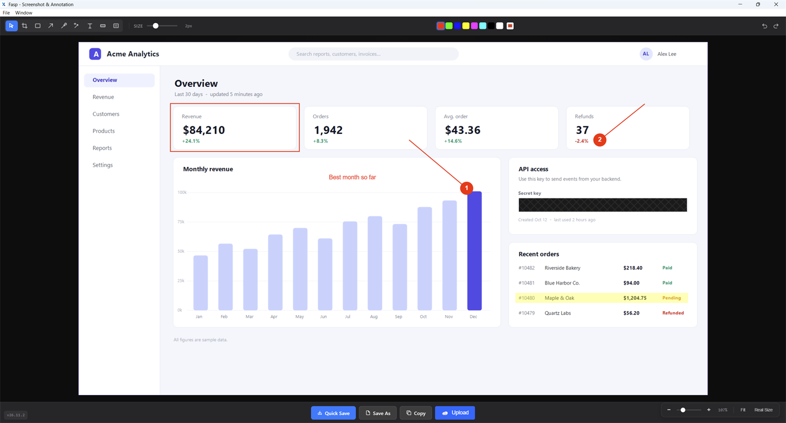
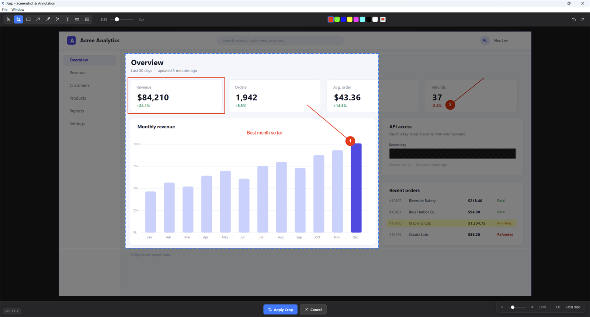
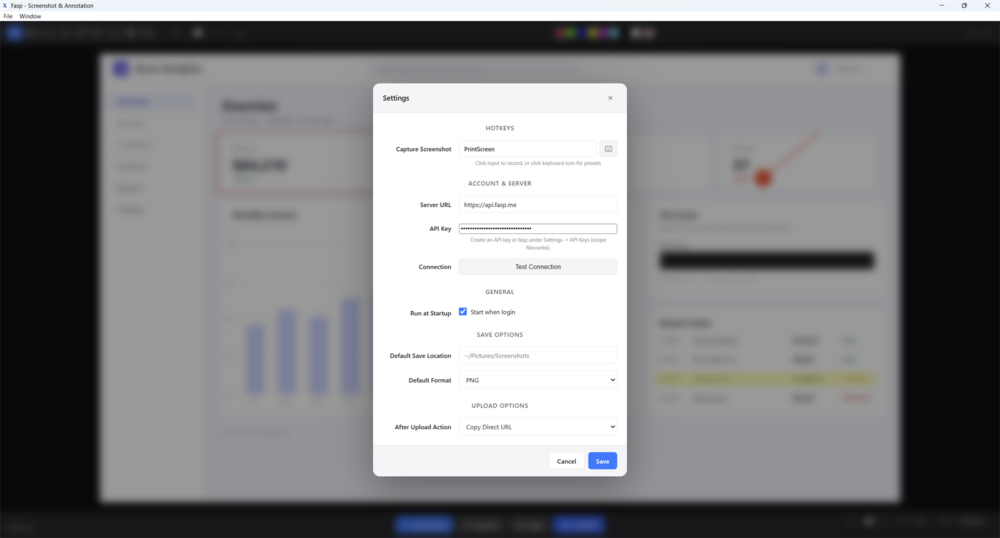

# Fasp

**Fast screenshot and annotation for Windows and macOS.** Press a hotkey, mark up the capture with boxes, arrows, numbered steps, text, highlights and blur, then copy, save or upload it in a second.



## Features

- **Global hotkeys**: capture the screen under the mouse cursor from anywhere, even with the editor hidden.
- **Native capture**: GDI on Windows, ScreenCaptureKit on macOS, in-process with no helper scripts; full resolution on scaled (HiDPI) displays.
- **Annotation tools**: rectangle, arrow, numbered arrow, arrow with text, text, highlight and blur, in eight colours and five sizes.
- **Blur that really hides things**: the blur box is fully opaque, so nothing underneath survives in the exported image.
- **Crop** after capturing, before you share.
- **Zoom and pan**: zoom with Ctrl + mouse wheel, hold Shift and drag to move around a large capture.
- **Copy, save or upload**: copy to the clipboard, quick-save to a folder, save as PNG or JPEG, or upload to a fasp server and get a link.
- **Tray icon** with recent screenshots, and an option to start at login.
- **Open any image** (PNG, JPEG, GIF, BMP, WebP) to annotate it.

## Install

### Windows

1. Download **`fasp-amd64-installer.exe`** from the [latest release](https://github.com/toniim/fasp-app/releases/latest).
   A portable `fasp.exe` is attached too.
2. Run the installer. It installs to `C:\Program Files\fasp\fasp` and fetches the Microsoft Edge WebView2 runtime if it is missing.
   The installer is not code-signed yet, so Windows SmartScreen may warn you: choose **More info → Run anyway**.
3. Fasp starts in the system tray. Press **PrintScreen** to capture.

Requires Windows 10 (1909) or later.

### macOS

Releases do not include a macOS build yet; build it from source (see [Development](#development)) with `make build-darwin-signed`.
Requires macOS 14 or later. On first capture, allow Fasp under **System Settings → Privacy & Security → Screen Recording**.

## Usage

### Capture

| Hotkey | Windows | macOS |
|---|---|---|
| Capture (set in Settings) | `PrintScreen` | `Cmd+Shift+5` |
| Second capture hotkey | `Ctrl+Shift+S` | `Cmd+Shift+6` |

Both capture the screen under the mouse cursor and open it in the editor with the **Crop** tool ready: drag to keep part of it, or pick another tool to annotate the whole capture.
The editor hides itself first, so it never appears in its own screenshot.

You can also capture from the tray menu or **File → Capture Screenshot**, and open an existing image with **File → Open Image…** (`Ctrl+O`).

### Annotate

Pick a tool in the toolbar or press its key, choose a colour and a size, then drag on the image.

| Tool | Key | What it does |
|---|---|---|
| Select | `S` | Select, move, resize and rotate annotations; drag on empty space to select several |
| Crop | `C` | Drag the area to keep, then **Apply Crop** (`Enter`) or **Cancel** (`Esc`) |
| Rectangle | `R` | Outline an area |
| Arrow | `A` | Point at something |
| Numbered arrow | `N` | Arrow with a step number that counts up: 1, 2, 3… |
| Arrow with text | `W` | Arrow with a label at its tail |
| Text | `T` | Drag a box and type; `Enter` adds a line, `Esc` or clicking away finishes |
| Highlight | `H` | Translucent marker over text |
| Blur | `B` | Opaque pattern that hides passwords, keys and personal data |

Size: `[` and `]`, or `Ctrl+1` … `Ctrl+5`. Undo `Ctrl+Z`, redo `Ctrl+Shift+Z`. Delete the selection with `Delete`, `Backspace` or `Ctrl+D`; select everything with `Ctrl+A`.



### Zoom and pan

- **Zoom**: `Ctrl` + mouse wheel zooms towards the cursor; the zoom bar has **−**, **+**, **Fit** and **Real Size** (pixel-exact).
- **Pan**: when the image is larger than the editor, hold **Shift** and drag from anywhere, with any tool, to move the view. `Ctrl` + drag on the image does the same. The mouse wheel scrolls; `Shift` + wheel scrolls sideways.

### Copy, save and upload

| Button | Shortcut | Result |
|---|---|---|
| Quick Save | `Ctrl+S` | Saves to the default folder (`Pictures\Fasp` unless set in Settings) |
| Save As | `Ctrl+Shift+S` | Choose a file name and format (PNG or JPEG) |
| Copy | `Ctrl+C` | Puts the annotated image on the clipboard |
| Upload | | Uploads to your fasp server and copies the link (see Settings) |
| | `Ctrl+Shift+C` | Cancels a crop, or hides the editor |

> On Windows, `Ctrl+Shift+S` is also the default second capture hotkey, which is global and wins: in the editor it starts a new capture instead of Save As. Use the **Save As** button, or change that hotkey in `settings.json` (`hotkeys.capture_region`).

On macOS, use `Cmd` in place of `Ctrl` for the editor shortcuts.

### Tray menu

Capture Screenshot, Open Image…, **Recents** (your latest saved screenshots and their folder), Show/Hide Window, Settings… and Quit.
On Windows, closing the editor window only hides it and Fasp keeps running in the tray; use **Quit** to exit.

### Settings

Open **Settings** from the tray or with `Ctrl+,`.



- **Hotkeys**: click the field and press a new combination, or pick a preset.
- **Account & Server**: the fasp server URL and an API key (create one in fasp under Settings → API Keys, scope `files:write`), with **Test Connection**.
- **Run at Startup**: start Fasp when you log in.
- **Save Options**: default folder and format for Quick Save.
- **Upload Options**: after an upload, copy the direct URL, the public URL, Markdown image code, or nothing.

Settings are stored in `%APPDATA%\fasp\settings.json` on Windows and `~/Library/Application Support/fasp/settings.json` on macOS. The file holds your API key, so it is readable only by you.

## Troubleshooting

- **A hotkey does nothing (Windows).** Another app may own it. Windows 11 can reserve `PrintScreen` for the Snipping Tool: turn off **Settings → Accessibility → Keyboard → Use the Print screen key to open screen capture**, or pick another hotkey in Fasp.
- **Captures are black or only show the wallpaper (macOS).** Grant **Screen Recording** permission and restart Fasp. Unsigned rebuilds lose the permission; build with `make build-darwin-signed` to keep it.
- **SmartScreen blocks the installer.** The installer is not code-signed yet: **More info → Run anyway**.

## Development

Requirements: Go (version in `go.mod`), Node.js 18+, and the [Wails](https://wails.io) CLI at the version pinned in `go.mod`.
`make install` installs the right Wails CLI; the build targets stop with a hint if yours differs.

```bash
git clone https://github.com/toniim/fasp-app.git
cd fasp-app
make install          # Go modules, frontend packages, pinned Wails CLI
make dev              # run with hot reload
make build            # production build for this OS, into build/bin
make build-windows    # Windows NSIS installer
make build-darwin-signed  # macOS app, signed so Screen Recording permission survives rebuilds
make test             # Go tests
```

The wails targets run on the Go toolchain from `go.mod` (through `GOTOOLCHAIN`), matching CI.
Without `make`, run the same `wails build` command with `GOTOOLCHAIN` set to that version.

### Releasing

1. Bump `Version` in `internal/version/version.go` (format `vYY.M.PATCH`) and merge it to `main`.
2. Run `make release` (or `scripts/release.sh`): it tags the commit and pushes the tag.
3. The Release workflow builds the Windows app and installer and publishes them as a GitHub release.

### Project layout

```
main.go                      Wails app, bindings for the frontend, window and tray wiring
focus_windows.go             Gives the web view keyboard focus when the editor is shown
internal/
  model/                     Settings and capture types
  service/
    capture/                 Screen capture (GDI on Windows, ScreenCaptureKit on macOS)
    clipboard/               Copy images (Win32 clipboard, NSPasteboard)
    hotkey/                  Global hotkeys
    file/                    Save/open dialogs, default save folder
    recents/                 Recently saved screenshots
    settings/                settings.json persistence
    startup/                 Start at login
    upload/                  Upload to a fasp server
    permission/, shell/      OS permissions, opening files and folders
  tray/                      System tray menu
  version/                   Version stamped at build time
frontend/src/
  components/EditorWindow/   Konva canvas editor, toolbar, zoom bar, action bar
  components/SettingsWindow/ Settings dialog
  store/                     Zustand stores
  utils/editor-geometry.ts   Fit, zoom and pan maths
build/                       Icons, Windows manifest and installer, macOS plists
docs/                        Design notes and architecture docs
```

Platform code lives in `_windows.go` / `_darwin.go` files. More background is in [`docs/`](docs/): [system architecture](docs/system-architecture.md), [code standards](docs/code-standards.md) and the [roadmap](docs/project-roadmap.md).

## License

[MIT](LICENSE)
